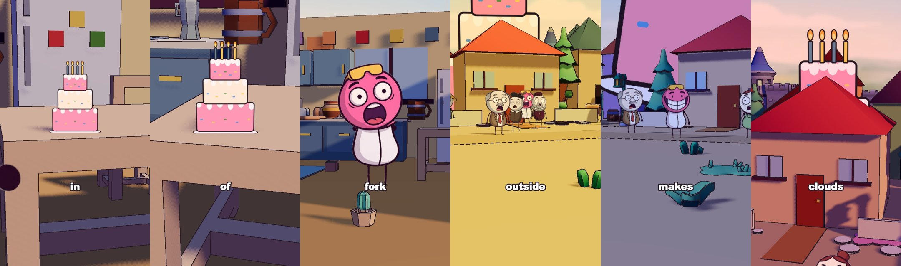
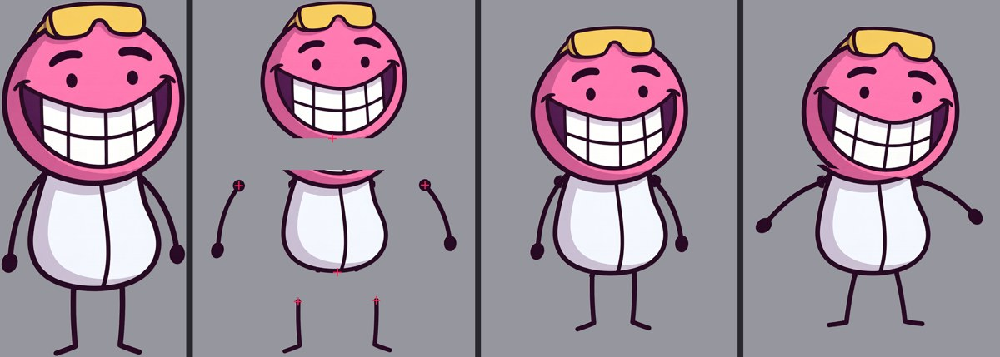
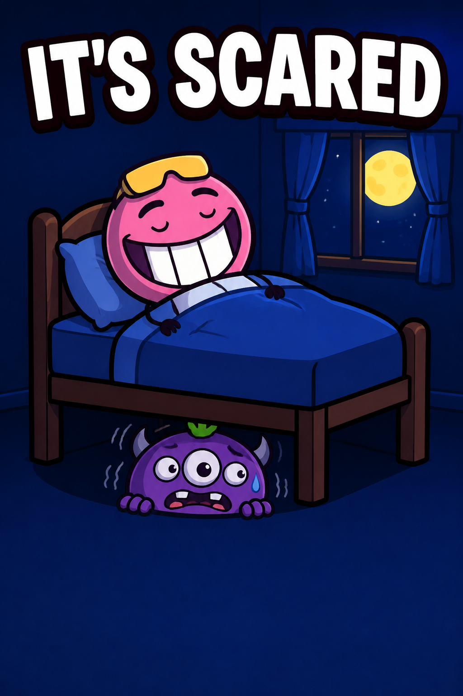
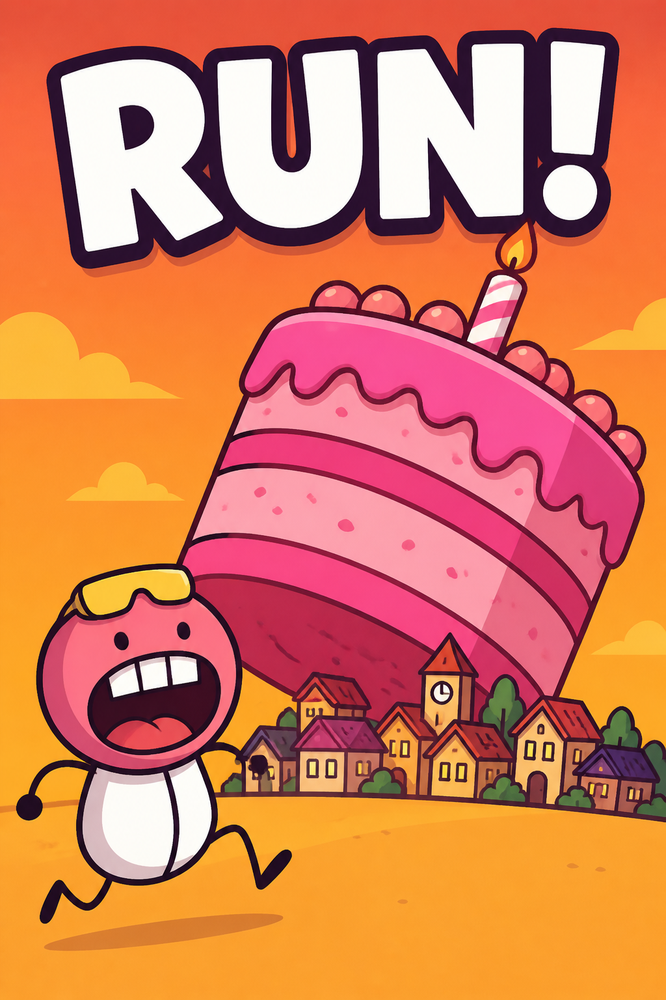
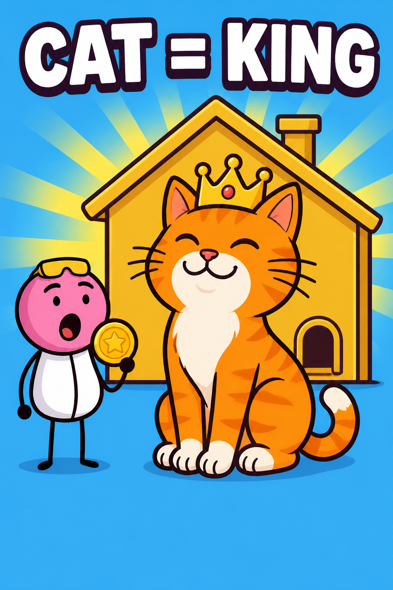
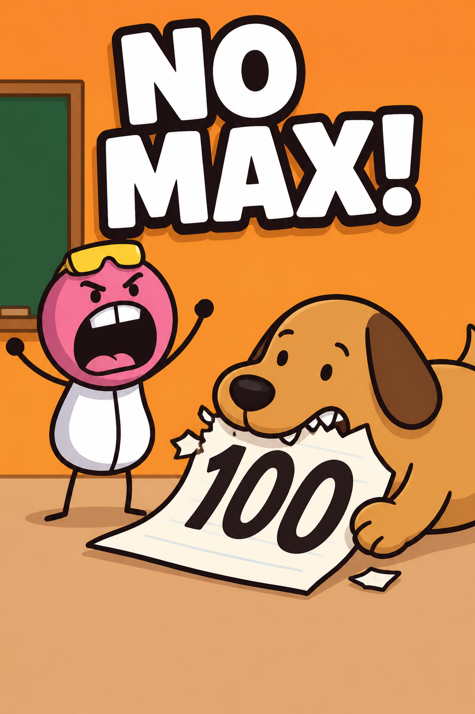
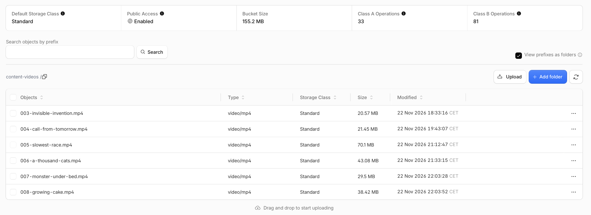
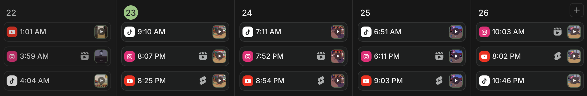
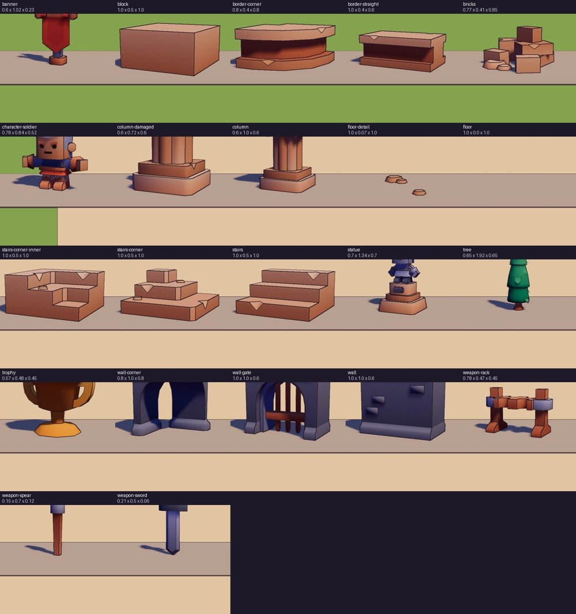

# TlamaLabs – faceless YouTube Shorts workflow

A workflow for producing one vertical Short (max 35 s) per day with [Claude Code](https://claude.com/claude-code). The videos are **"What if…?" questions** answered with checked science (hook → escalation ladder → "But here is the real problem." → looping finale), with one recurring hero as the test subject. Flat 2D doodle characters stand in a 3D world built entirely in code (three.js), and the result is rendered to MP4 (1080×1920, 30 fps).

Channel: [@TlamaLabs](https://www.youtube.com/@TlamaLabs). Visual style inspired by @RicksClips3000.



## Quick start (commands)

```bash
--cv                                              # type this in the Claude Code chat: starts a new video
node scripts/publish/publish.mjs --channels       # check the Buffer key, list connected channels
node scripts/publish/publish.mjs --dry NNN        # preview what would be published
node scripts/publish/publish.mjs NNN              # queue video NNN on YouTube, Instagram and TikTok
node scripts/publish/publish.mjs --now NNN        # publish video NNN immediately on all platforms (no queue)
```

`NNN` is the video number, e.g. `009`.

## Services and keys (`.env`)

| Service | Used for | Needed? |
| --- | --- | --- |
| **Buffer** (API key) | queues the finished video on YouTube, Instagram and TikTok | for publishing |
| **Cloudflare R2** (bucket + keys) | temporary public hosting of `video.mp4`, which Buffer needs to fetch | for publishing |
| **Higgsfield** (Claude connector) | generates new characters, emotion sheets and backgrounds | only when adding new characters or backgrounds; rendering works without it |
| **Nano Banana / Higgsfield image generator** | I paste the thumbnail prompts here by hand | manual step, optional |
| **ElevenLabs** | I record the voiceover here myself; Claude only writes the tagged script | manual step |

Keys live in `.env` (copy `.env.example` and fill it in). `.env` is git-ignored, never commit it. Higgsfield is not a key: it is a connector enabled in Claude Code.

## How it works

1. `--cv` – Claude creates an empty `videos/NNN/` folder and proposes 3 original "What if" ideas (hook, escalation, finale, rating 1–10).
2. **Pick one** – Claude checks the facts (`facts.md` with sources), then writes the voice script with ElevenLabs audio tags.
3. **Record the voice** – I generate the voiceover myself and drop it into `videos/NNN/` as the only `.mp3`, then tell Claude it's done. Claude never generates the voice.
4. **Production** – Claude renames the folder to `NNN-slug` and runs the whole pipeline (below) without asking questions.
5. **Review** – Claude reports the result and runs a dry run of the publishing step. I watch `video.mp4`.
6. **Publish** – only on my explicit command: `publish.mjs NNN` uploads the video to Cloudflare R2 and queues it through the Buffer API.

## The production pipeline

1. **Voice** – `scripts/voice.sh` (ffmpeg) cuts the silences between sentences and always speeds the track up at least 1.25x, and more if needed so it is strictly at most 35 s. The raw take is never overwritten.
2. **Timing** – Whisper aligns every word to the processed voice (`words.json`), which drives the 1–2 word captions and the cuts.
3. **Scene** – a Python generator (copied from a template video) writes `short.json`: about 40 shots per video (one per phrase), 3 locations with 120–200 props each, light moods that change on story turns, and a camera that moves in every shot. Characters are rigged cutouts, props are ready-made GLB models plus primitives.
4. **Check** – before the full render, `render.mjs --stills` renders three stills per shot and flags mechanical problems (camera inside a prop, character hidden or off screen, too dark, too bright, flat frame, pure black). A contact sheet is also reviewed for dull or repetitive neighbouring shots.
5. **Fix** – Claude edits the scene and re-runs the check until it reports nothing. Errors are fixed automatically; I'm only told about things that need me.
6. **Render** – the full video, then `shortkit.py check` measures camera speed and zoom against the style's ranges.
7. **Deliver** – `video.mp4`, `script.txt` and `metadata.md` (title and caption per platform) are saved, followed by the publish dry run and a short report.



*The hero, Tlama: source cutout, layers, re-assembled, posed. Limbs rotate at the shoulder and hip, the head tilts, faces are swapped per shot.*

## Thumbnails (prompts + AI image generator)

Thumbnails are not rendered from the 3D stage. At the end of every video, the `tlama-thumbnail` skill reads the script and writes **3 ready-to-paste image prompts** into `thumbnail_prompts.md` in the video folder. Each prompt combines Tlama (pink round head, big grin, yellow goggles) with one key thing from the story and 1–3 words of big outlined text, drawn in a punchy "clickbait" version of the channel style.

How I use it:

1. Open `thumbnail_prompts.md` and pick one of the 3 variants.
2. Paste the prompt into an image generator (Nano Banana or Higgsfield) and attach `puppets/main_hero_tlama/source.png` as the reference, so Tlama looks the same every time.
3. Download the result and upload it as the custom thumbnail by hand in YouTube Studio (Buffer cannot set thumbnails).

Shorts are 1080×1920 (9:16), long-form videos are 1280×720 (16:9). Examples generated from the prompts (monster under the bed, giant cake, wish coin, dog ate homework):

<p>
  
  
  
  
</p>

## Automated publishing (Cloudflare R2 + Buffer)

Publishing is fully automated by `scripts/publish/publish.mjs`, so no video is uploaded by hand:

1. **Cloudflare R2** – the script uploads `video.mp4` to a public R2 bucket (`NNN-slug.mp4`). Buffer can only post a video from a public URL, so R2 acts as the temporary hosting. Keep the file there until the post has gone out.

   

2. **Buffer** – the script then creates the posts through the Buffer API, using the texts from `metadata.md`. Each video goes into the next free slot of the queue on YouTube Shorts, Instagram Reels and TikTok, so I never pick publishing times by hand.

   

Videos that were already published are recorded in `.published.json` and skipped on the next run, so it is safe to run the command again.

## Folder structure

```
videos/NNN-slug/
  video.mp4        final render
  script.txt       script without audio tags
  metadata.md      titles and captions per platform (YouTube, Instagram, TikTok)
  thumbnail_prompts.md  3 image prompts for the thumbnail
  work/            per-video working files (voice, scene, stills), safe to delete
puppets/           reusable characters, overview in PUPPETS.md
props/             ready-made 3D models (GLB packs) + catalog.json
bg/                background paintings
music/             the shared music track
scripts/           scene generator template, voice.sh, set_dressing.py, publish/
.claude/skills/    ricksclips-short-style (stage, render, rules), tlama-longform, tlama-thumbnail
docs/images/       images used in this README
CLAUDE.md          project rules and instructions for Claude
```

Every video lives in its own folder, so several can be produced in parallel and any of them can be deleted without breaking the others. Shared assets are only ever added to, never edited.



*Each model pack in* `props/` *has a preview sheet (here a Kenney CC0 pack) that Claude reads when dressing a scene.*

## Setup

- Node.js, Python 3, `ffmpeg` and `ffprobe` on PATH.
- Render stage (once):
  ```bash
  cd .claude/skills/ricksclips-short-style/scripts/stage
  npm install && npx playwright install chromium
  ```
- Python environment with `numpy pillow scipy opencv-python-headless faster-whisper` in `.venv`.
- Publishing: `cd scripts/publish && npm install`, then fill in `.env` (see above).

## Note on this repository

`videos/`, `puppets/`, `props/`, `bg/` and `music/` are listed in `.gitignore` (large binary assets), so they are not part of the repository. You need to supply your own characters, 3D models and music to reproduce the pipeline.
